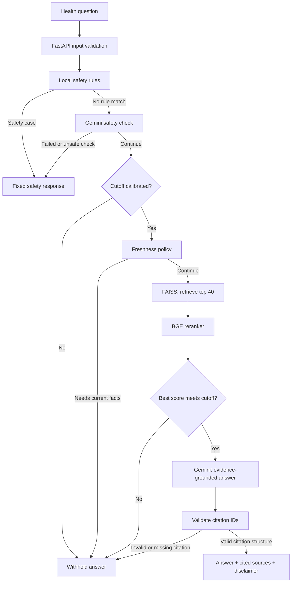

# Healthcare RAG Assistant

A small, source-grounded **retrieval-augmented generation (RAG)** assistant for general health questions. It retrieves relevant passages from a curated knowledge base, generates an answer from that evidence, and checks that the answer's citation IDs point to sources that were actually supplied.

> **Educational project only.** This is a graduation project, not a medical device or clinical service. It is not intended to diagnose conditions, recommend treatment, or replace advice from a qualified healthcare professional. The project has not been clinically validated.

## Why this project?

The main engineering question is not simply how to call an LLM. It is how to decide **when the system has enough evidence to answer and when it should abstain**—and how to evaluate that behavior without presenting a score as proof of medical correctness.

## What it does

- Retrieves passages from a curated health knowledge base using dense search and a cross-encoder reranker.
- Generates answers from retrieved evidence and returns source links with `[n]` citations.
- Abstains when evidence is too weak, a question requires current information, the cutoff is uncalibrated, or citation validation fails.
- Routes emergency, harmful, and personal-medical-advice requests to fixed safety messages rather than generating a medical response.
- Uses one shared `RAGPipeline` implementation across the FastAPI app and the notebooks.

## Architecture



### Key design choices

| Component | Purpose | Important limitation |
|---|---|---|
| `BAAI/bge-m3` embeddings + FAISS | Find semantically related passages | Not benchmarked against alternative embedding models in this project |
| `BAAI/bge-reranker-v2-m3` | Re-rank retrieved passages for the question | Retrieval relevance has not been measured against a ground-truth relevance set |
| Reranker-score cutoff | Decide whether the evidence is strong enough to proceed | The score is a raw reranker logit, **not a probability**; changing retrieval models or settings requires recalibration |
| Local rules + Gemini safety check | Catch known safety patterns and check unmatched questions | Neither layer is a guarantee of safety; the Gemini safety check has not been independently validated |
| Structural citation validation | Reject citation IDs that do not map to supplied passages | A valid citation ID does not prove that the cited passage supports the associated claim |
| Fixed safety responses | Avoid generating free-form replies for defined safety cases | The local rules are pattern-based and can miss unfamiliar wording |

The implementation intentionally avoids agents, a separate database, a hosted vector service, authentication, and deployment infrastructure. Those additions are not required to demonstrate this project's core idea.

## Knowledge base

| Source | Use | Attribution / licence notes |
|---|---|---|
| [MedQuAD](https://github.com/abachaa/MedQuAD) (`lavita/MedQuAD`, revision pinned in `src/config.py`) | Health question-and-answer pairs collected from NIH-related websites | CC BY 4.0, as documented by the source dataset |
| [MedlinePlus health-topic XML](https://medlineplus.gov/xml.html) | English health-topic documents and aliases | Follow [MedlinePlus reuse guidance](https://medlineplus.gov/about/using/usingcontent/) |
| [USPSTF](https://www.uspreventiveservicestaskforce.org/) | Selected recommendations on breast, colorectal, and blood-pressure screening | Check source-specific reuse terms when redistributing content |

Preprocessing in `src/kb.py` is deliberately small and auditable:

- Drops MedQuAD rows without answers and resolves duplicate questions by keeping the longer answer.
- Avoids duplicating MedlinePlus topics when the official XML supplies the same topic.
- Parses HTML and removes trailing navigation boilerplate only when it appears at the end of a document.
- Splits documents into chunks of approximately 1,000 characters at sentence boundaries, with a one-sentence overlap. Each chunk starts with the document question to preserve context.
- Saves the index, chunk table, manifest, and checksums together. Loading fails when key metadata or fingerprints disagree, rather than silently serving an incompatible index.

Generated artifacts under `data/raw/`, `data/processed/`, `data/index/`, and `reports/` are created locally and are not committed. A fresh clone must build the knowledge base before the full app can answer questions.

## Quick start

Requirements: **Python 3.11 or 3.12**, internet access for downloading source data and model weights, and several gigabytes of free disk space. Model downloads take substantially more space than the FAISS index itself.

The commands below use Windows PowerShell:

```powershell
py -3.12 -m venv .venv
.\.venv\Scripts\Activate.ps1
python -m pip install --upgrade pip
python -m pip install -r requirements.txt
Copy-Item .env.example .env
```

Add a Google AI Studio API key to `.env`:

```dotenv
GOOGLE_API_KEY=your_key_here
```

The key is used for answer generation and for the Gemini safety check. The optional LLM-judge evaluation also supports a Groq or Cerebras provider key. Never commit `.env` or API keys.

### Build the knowledge base and index

Run these notebooks in order from the activated environment:

1. `notebooks/01_data_and_kb.ipynb` — downloads and preprocesses the sources; writes `data/processed/kb_documents.csv`.
2. `notebooks/02_build_index.ipynb` — chunks and embeds the documents, builds and checks the FAISS index, and selects an evidence cutoff using development questions only.

Notebook 02 does not call an LLM provider. Encoding the full corpus can take time on CPU; a CUDA-capable GPU can speed it up.

### Run the web demo

After building the index and generating a valid cutoff file:

```powershell
uvicorn app:app --reload
```

Open [http://127.0.0.1:8000/](http://127.0.0.1:8000/).

The API provides:

- `GET /` — static demo UI.
- `GET /health` — app and index status.
- `POST /query` — submit a question.

The health endpoint reports `loading` or `error` as HTTP 503, and `ok` or `degraded` as HTTP 200. In a degraded state (for example, when the cutoff is absent or stale), the pipeline fails closed and withholds answers instead of guessing.

Each `/query` request has a 60-second budget. The deadline is shared across pipeline stages and caps provider request timeouts at the remaining time. An in-flight provider request cannot be forcibly interrupted; its socket timeout is the practical limit.

### Walk through the pipeline

`notebooks/03_rag_pipeline.ipynb` shows retrieval, reranking, the cutoff decision, prompt construction, and how the notebook uses the same `RAGPipeline` as the app. Live generation is not required for the walkthrough.

## Tests

```powershell
python -m pytest -q
```

The test suite is designed to run without an API key, GPU, model download, or network access. It uses small test indexes and fake encoders, rerankers, and provider clients. Tests cover safety rules, pipeline decisions, citation parsing, deadlines, retries, calibration, metric definitions, API behavior, and data validation.

## Evaluation

Evaluation questions live in `data/eval/`:

- `dev_questions.csv` — 168 questions used during development and for cutoff selection.
- `test_questions.csv` — 87 questions reviewed during development. This is an **exploratory test set, not an untouched holdout**.

The sets contain no exact duplicate questions, but some questions share templates. The question labels, generated answers, and LLM-judge rubric have not been reviewed by clinicians. Results therefore measure project-defined behavior on these fixtures; they do not establish medical correctness or clinical safety.

### Metrics

The definitions are implemented in `src/metrics.py`.

| Metric | What it measures | What it does not establish |
|---|---|---|
| Outcome accuracy | Whether the pipeline's outcome matches the question's `expected_behavior` label | Whether a generated medical answer is factually correct |
| Abstention recall / precision | How consistently the pipeline withholds questions labelled as requiring abstention, over the eligible denominator | That all unsafe or unsupported questions will be caught |
| Over-refusal | How often answerable questions are withheld for an evidence decision | The quality of answers that are returned |
| Citation-ID validity | Whether every returned `[n]` citation points to a supplied passage | Whether the passage actually supports the claim |
| Optional LLM-judge scores | Model-estimated context relevance, faithfulness, and answer relevance | A validated substitute for human or clinical review |

Safety redirects, refusals, provider errors, and evidence-based abstentions are tracked as different outcomes. They should not all be counted as the same kind of abstention. Similarly, the calibration score and runtime abstention metrics have different denominators: calibration selects a reranker cutoff on the relevant development subset, while the runtime pipeline can make earlier safety or freshness decisions.

### Previously saved exploratory output

The notebook's saved output dated **25 October 2026** recorded the following. These figures have **not been re-verified against the latest code changes**, so rerun Notebook 04 before presenting them as results for a current build.

| Measure in saved output | Development set | Exploratory test set |
|---|---:|---:|
| Outcome accuracy | 153/168 (**91.1%**) | 79/87 (**90.8%**) |
| Abstention recall over eligible evidence decisions | 19/23 (**82.6%**) | 11/14 (**78.6%**) |
| Returned answers with structurally valid citation IDs | 96/96 (**100%**) | 48/48 (**100%**) |

**Interpret these carefully:** outcome accuracy is agreement with the project's expected-behavior labels, not medical answer accuracy. Citation validity is structural only. The test set was used during development, and neither set has clinician-reviewed labels. The saved LLM-judge results are omitted from this headline table because the judge is unvalidated and those values are estimates.

To produce a fresh report, open `notebooks/04_evaluation.ipynb` and review its run flags before executing cells. Enabling development/test evaluations or the optional LLM judge can make live provider calls; check the planned call count and provider costs before running. Reports are written under `reports/evaluation/` and are generated locally, not committed.

### Cutoff calibration

Notebook 02 selects the reranker-score cutoff from development questions only. The saved calibration output used 94 answerable questions and 16 true no-evidence questions for the cutoff calculation; 16 policy-scope `insufficient_evidence` examples were excluded from that optimization. The previously saved cutoff was approximately `-0.497`, with a reported calibration target of `0.90` and achieved value of `0.938` on that calibration subset. These figures are from the saved run and should be recomputed after changes to the data, index, retrieval models, score-producing settings, or relevant pipeline/safety versions.

A genuinely untouched holdout, labelled retrieval-relevance examples, and clinician review of a sample of questions and answers are the highest-value next evaluation steps.

## Safety and limitations

- **English only.** The current knowledge base and evaluation fixtures are English-language.
- **Not real-time.** The knowledge base is static and some source pages may have changed or been retired. Questions requiring current facts are withheld by policy.
- **Safety checks are not a guarantee.** Local rules are pattern-based. The Gemini check is a second layer, but its independent accuracy has not been measured by this project.
- **No clinical validation.** The question labels, answers, and judge rubric have not been reviewed by clinicians.
- **No semantic citation verification.** Citation validation checks source references, not whether the cited text entails the answer.
- **Privacy.** Unmatched questions may be sent to the configured provider for safety classification, and questions that proceed may also be sent for generation. Do not submit names, identifying details, or private medical information.

The project's regex-only development fixtures also show why local patterns should not be treated as a complete safety classifier:

| Fixture | Urgent cases escalated | Harmful requests withheld | Educational questions left alone |
|---|---:|---:|---:|
| 50-question holdout | 2/24 | 1/10 | 16/16 |
| Different-wording probes | 6/42 | 1/9 | 8/12 |

These are small development fixtures, not evidence of clinical safety. They show that the local rules are strongest on familiar wording and weak on many rephrasings; the Gemini check is an additional layer, not a guarantee.

## Project structure

```text
app.py                    FastAPI endpoints and static demo
frontend/                 Static UI; no frontend build step
src/pipeline.py           Shared RAG orchestration path
src/safety.py             Local safety rules and fixed responses
src/safety_check.py       Gemini safety classification for unmatched questions
src/retriever.py          FAISS retrieval, reranking, source grouping
src/generator.py          Grounded generation, retries, citation parsing
src/kb.py                 Data cleaning, chunking, index build/load
src/calibration.py        Development-only cutoff selection and metadata
src/metrics.py            Outcome, abstention, citation, and judge metrics
src/evaluation.py         Evaluation runner and report writer
src/deadline.py           Shared request deadline
src/retry.py              Bounded retries for transient provider errors
src/config.py             Paths, model pins, provider settings, validation
notebooks/                Data, index, pipeline walkthrough, evaluation
data/eval/                 Development and exploratory test questions
tests/                     Automated tests and safety fixtures
```

## Rebuilding after changes

| Change | Required follow-up |
|---|---|
| Source data, preprocessing, or chunking in `src/kb.py` | Rerun Notebooks 01 and 02, then recalibrate |
| Embedding model, reranker model, or settings that change reranker scores | Rebuild the index and recalibrate in Notebook 02 |
| `RAG_PIPELINE_VERSION` or safety-rule behavior/version | Recalibrate and verify the cutoff metadata |
| Prompt or generation settings | Rerun evaluation; the cutoff does not directly depend on prompt wording |
| Evaluation questions or expected-behavior labels | Review the labels and rerun calibration/evaluation as applicable |

The app validates cutoff metadata against the current build. If the threshold fingerprint does not match the index, model settings, development data, or relevant version values, the app should fail closed rather than use a cutoff from a different configuration. Treat recalibration as a correctness requirement, not a formality.

## Licence

The project code is MIT licensed; see [`LICENSE`](LICENSE). The datasets and model weights have their own terms. Review the linked source guidance and model licences before redistribution.
